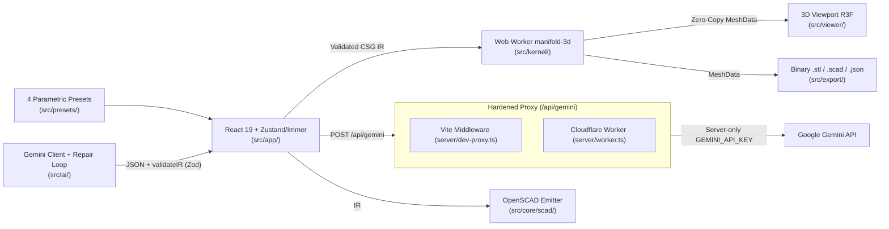

# Text-to-CAD 🧊

> 🌐 **English** · [Leia em Português (PT-BR)](README.pt-BR.md)

[-6366f1.svg?style=for-the-badge)](docs/architecture/visao-geral.md)
[-10b981.svg?style=for-the-badge)](tests/)
[](e2e/)
[](tsconfig.json)
[](LICENSE)

[](package.json)
[](package.json)
[](src/ai/)
[](wrangler.toml)

**Natural-language to parametric 3D CAD engine in the browser — deterministic CSG geometry, interactive Three.js viewport, and verified binary `.stl` / `.scad` export.**

---

## ⚡ TL;DR — Why This Exists

Asking an LLM to write raw OpenSCAD code or raw triangle meshes produces broken geometry, non-manifold edges, and security risks. **Text-to-CAD enforces a deterministic compiler boundary**:

- **Structured CSG Intermediate Representation (IR):** Gemini outputs only a strict JSON CSG tree validated by **Zod** (`validateIR`, `MAX_NODES = 200`, mm, Z-up) with an automated self-repair loop (up to `2` retries passing `IRIssue[]` diagnostics back to the model).
- **WASM CAD Kernel in a Web Worker:** Geometry is evaluated off the main thread by **manifold-3d** (`10s` timeout, `AbortSignal` cancellation, zero-copy transferable `MeshData`) and exported as verified binary `.stl` (`84 + 50 * triCount` bytes), deterministic `.scad`, or `.json`.
- **Hardened AI Proxy & Secret Hygiene:** Server-side `/api/gemini` proxy (Vite dev middleware + Cloudflare Worker with fail-closed CORS, `150 KB` stream cap, and sliding-window rate limiting) + optional **BYOK** strictly isolated in `sessionStorage` + pre-commit & CI secret scanning (`check:secrets` + `gitleaks`).
- **Verified Engineering Rigor:** **201 unit tests (20 suites)**, **95.22% statement / 97.06% line coverage**, **5/5 Playwright E2E tests** (desktop & mobile), TypeScript `strict`, and ADRs ([`ADR-001`](docs/adr/ADR-001-stack.md), [`ADR-002`](docs/adr/ADR-002-ir-contrato.md)).

---

## 🏗️ Architecture & Deterministic Pipeline



---

## ✨ Key v1 Capabilities

- **AI Prompt Engine (`src/ai/`, `server/`):** Gemini Structured Outputs with recursive `$ref` schema adaptation, anti-prompt-injection system prefix, concurrency/rate limits (`1` active, `10/min`), `30s` timeout, 2-step `IRIssue[]` repair loop, and `sessionStorage`-scoped BYOK.
- **4 Parametric Presets (`src/presets/`):** *L-Bracket*, *Flange with Holes*, *Divider Box*, and *Bushing / Spacer* — real-time sliders guarded by invariant clamping (`clampParams`).
- **3D Viewport & `/lab` Route (`src/viewer/`, `src/app/`):** Z-up coordinate system, 4 render modes (*Solid*, *Wireframe*, *Clay*, *X-Ray*), millimetric grid, projected X/Y/Z dimensions, volume (`cm³`), triangle count, and side-by-side inspection on `/lab`.
- **Verified Exports (`src/export/`):** Validated binary `.stl` (`80`-byte header + `50` bytes/triangle), deterministic `.scad`, and raw `.json` IR.
- **Productivity & Accessibility (`src/app/`, `src/i18n/`):** Immutable `zustand` + `immer` store, Undo/Redo (`Ctrl+Z` / `Ctrl+Shift+Z`), `localStorage` history (up to `20` models with key redaction), WAI-ARIA mobile tabs, skip link, and centralized PT-BR UI dictionary (`src/i18n/pt-BR.ts`).

---

## 🚀 Running Locally

Requires **Node.js 22+**.

```bash
npm install
npm run dev          # http://localhost:5173 (editor) and http://localhost:5173/lab
npm test             # 201 unit tests across 20 suites (Vitest)
npm run coverage     # >=80% coverage gate (95%+ achieved)
npm run e2e          # 5 Playwright E2E tests (run: npx playwright install chromium)
npm run lint && npm run typecheck && npm run build
```

---

## 🔐 Gemini API Key & Security Invariants

API credentials **never** enter the repository or browser bundle:

1. **Local `.env.local`:** Copy `.env.example` to `.env.local` (git-ignored) and set `GEMINI_API_KEY`. Never use `VITE_` prefixes for secrets.
2. **UI BYOK Mode:** Open *Chave própria (BYOK)* in the left panel; the key stays strictly in tab `sessionStorage` and travels only in the `x-user-key` header to `/api/gemini`.
3. **Reference AI Eval (10 Prompts):** With `GEMINI_API_KEY` in `.env.local`:
   ```bash
   npm run eval:ai
   ```
4. **CI & Hook Guards:** `.githooks/` pre-commit and CI (`npm run check:secrets`, `dist/` bundle scan, and `gitleaks`) block any secret leakage.

---

## ☁️ Deployment (Cloudflare Pages + Worker)

- **Frontend:** Build `dist/` via `npm run build` and deploy to Cloudflare Pages.
- **Proxy `/api/gemini`:** Configured in [`server/worker.ts`](server/worker.ts) and [`wrangler.toml`](wrangler.toml) with **fail-closed CORS** when `ALLOWED_ORIGINS` is unset:
  ```bash
  npx wrangler secret put GEMINI_API_KEY
  npx wrangler secret put ALLOWED_ORIGINS
  npx wrangler deploy
  ```

---

## 📂 Repository Layout

```text
src/core/      Frozen IR contract, Zod schema, validation guardrails & OpenSCAD emitter
src/kernel/    WASM CSG evaluation via manifold-3d in isolated Web Worker
src/viewer/    React Three Fiber 3D viewport (Z-up, 4 render modes, dimensions)
src/presets/   4 parametric CAD models + invariant clamping
src/export/    Binary .stl, .scad, and .json exporters
src/ai/        Gemini client, adapted schema, prompts, rate limiter & BYOK
server/        Hardened /api/gemini proxy (Vite dev middleware + Cloudflare Worker)
src/app/       React 19 shell, Zustand/Immer store, localStorage history & /lab route
src/i18n/      Centralized PT-BR interface dictionary
docs/          Architecture overview & ADRs (ADR-001, ADR-002)
```

---

## 📄 License

Distributed under the **MIT** license. See [`LICENSE`](LICENSE) for details.
