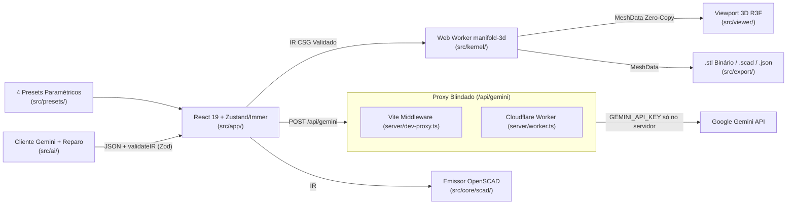

# Text-to-CAD 🧊

> 🌐 [Read in English](README.md) · **Português (PT-BR)**

[-6366f1.svg?style=for-the-badge)](docs/architecture/visao-geral.md)
[-10b981.svg?style=for-the-badge)](tests/)
[](e2e/)
[](tsconfig.json)
[](LICENSE)

[](package.json)
[](package.json)
[](src/ai/)
[](wrangler.toml)

**Descreva uma peça em português e gere modelos 3D paramétricos no navegador — geometria CSG determinística, viewport Three.js interativo e exportação `.stl` / `.scad` pronta para impressão 3D.**

---

## ⚡ Resumo Executivo — Por que Este Projeto Existe

Pedir para um LLM gerar malhas de triângulos ou código OpenSCAD direto resulta em geometria quebrada, sólidos não-manifold e riscos de segurança. O **Text-to-CAD impõe uma fronteira determinística de compilador**:

- **IR CSG Validado por Contrato:** O Gemini gera apenas uma árvore CSG estruturada validada por **Zod** (`validateIR`, `MAX_NODES = 200`, mm, Z-up) com loop automático de reparo (até `2` reenvios com diagnósticos `IRIssue[]`).
- **Kernel CAD WASM em Web Worker:** A geometria é avaliada fora da thread principal pelo **manifold-3d** (timeout de `10s`, cancelamento via `AbortSignal`, `MeshData` zero-copy) e exportada como `.stl` binário verificado (`84 + 50 * triCount` bytes), `.scad` determinístico ou `.json`.
- **Proxy Blindado e Higiene de Segredos:** Proxy `/api/gemini` no servidor (middleware Vite em dev + Cloudflare Worker com CORS *fail-closed*, teto de stream de `150 KB` e rate limit) + opção **BYOK** isolada em `sessionStorage` + bloqueio de segredos no pré-commit e CI (`check:secrets` + `gitleaks`).
- **Rigor de Engenharia Verificado:** **201 testes unitários (20 suítes)**, **95,22% de cobertura de statements / 97,06% de lines**, **5/5 testes E2E Playwright** (desktop e mobile), TypeScript `strict` e ADRs ([`ADR-001`](docs/adr/ADR-001-stack.md), [`ADR-002`](docs/adr/ADR-002-ir-contrato.md)).

---

## 🏗️ Arquitetura e Pipeline Determinístico



---

## ✨ Funcionalidades da v1

- **Prompt IA em PT-BR (`src/ai/`, `server/`):** Structured Outputs no Gemini com adaptação para `$ref` recursivo, proteção anti-prompt-injection, rate limit (`1` por vez, `10/min`), timeout de `30s`, loop automático de reparo (até `2` reenvios) e **BYOK** isolado em `sessionStorage`.
- **4 Presets Paramétricos (`src/presets/`):** *Suporte em L*, *Flange com Furação*, *Caixa com Divisórias* e *Bucha / Espaçador*, com sliders instantâneos e invariantes protegidos (`clampParams`).
- **Viewport 3D & Rota `/lab` (`src/viewer/`, `src/app/`):** eixo Z para cima, 4 modos (*Sólido*, *Wireframe*, *Argila*, *Raio-X*), grid milimétrico, cotas X/Y/Z, volume em cm³, contagem de triângulos e inspeção lado a lado em `/lab`.
- **Exportação Verificada (`src/export/`):** `.stl` binário verificado (header 80 bytes + `50` bytes/triângulo), código `.scad` determinístico e `.json` do IR.
- **Produtividade & A11y (`src/app/`, `src/i18n/`):** store imutável (`zustand` + `immer`), Desfazer/Refazer (`Ctrl+Z` / `Ctrl+Shift+Z`), histórico de até `20` modelos no `localStorage` (com redação de chaves), abas mobile WAI-ARIA, skip link e dicionário centralizado em `src/i18n/pt-BR.ts`.

---

## 🚀 Rodando Localmente

Requer **Node 22+**.

```bash
npm install
npm run dev          # http://localhost:5173 (editor) e http://localhost:5173/lab
npm test             # 201 testes unitários em 20 suítes (Vitest)
npm run coverage     # cobertura mínima de 80% (95%+ atingida)
npm run e2e          # 5 testes Playwright end-to-end (antes: npx playwright install chromium)
npm run lint && npm run typecheck && npm run build
```

---

## 🔐 Chave do Gemini & Avaliação IA

A chave **nunca** entra no repositório nem no bundle do navegador:

1. **Via `.env.local` (dev):** copie `.env.example` para `.env.local` (ignorado pelo Git) e preencha `GEMINI_API_KEY`. Nunca use prefixo `VITE_` para segredos.
2. **Via interface (BYOK):** abra *Chave própria (BYOK)* no painel esquerdo; a chave fica restrita ao `sessionStorage` da aba e vai apenas no header `x-user-key` para `/api/gemini`.
3. **Eval manual dos 10 prompts de referência:** com `GEMINI_API_KEY` em `.env.local`, rode `npm run eval:ai`.

---

## ☁️ Deploy (Cloudflare Pages + Worker)

- **Frontend:** gere `dist/` com `npm run build` e publique no Cloudflare Pages.
- **Proxy `/api/gemini`:** definido em [`server/worker.ts`](server/worker.ts) e [`wrangler.toml`](wrangler.toml) com CORS *fail-closed* por padrão se `ALLOWED_ORIGINS` não estiver definido:
  ```bash
  npx wrangler secret put GEMINI_API_KEY
  npx wrangler secret put ALLOWED_ORIGINS
  npx wrangler deploy
  ```

---

## 📄 Licença

Distribuído sob a licença **MIT**. Consulte [`LICENSE`](LICENSE) para mais informações.
