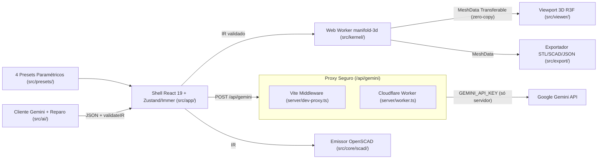

# Arquitetura Text-to-CAD v1

## Visão Geral do Fluxo



## Organização de Pastas e Fronteiras

| Módulo                   | Responsabilidade                                                                                                                                                                                          | Fonte de Verdade / Contratos  |
| ------------------------ | --------------------------------------------------------------------------------------------------------------------------------------------------------------------------------------------------------- | ----------------------------- |
| `src/core/`              | Contrato congelado (`contracts.ts`), IR Zod, guardrails (`MAX_NODES=200`, mm, Z-up), `irJsonSchema()` e emissor OpenSCAD                                                                                  | `ADR-002`, congelado desde M1 |
| `src/kernel/`            | Avaliação CSG WASM (`manifold-3d`) em Web Worker isolado com fila unitária, timeout (`10 s`) e cancelamento (`AbortSignal`)                                                                               | `Evaluate` em `contracts.ts`  |
| `src/viewer/`            | Viewport R3F (`frameloop="demand"`), 4 modos (`solid`, `wireframe`, `clay`, `xray`), grade 1/10 mm, eixos Z-up, cotas projetadas e `prefers-reduced-motion`                                               | `Viewport3DProps`             |
| `src/presets/`           | 4 presets (`suporte-l`, `flange`, `caixa-divisorias`, `bucha`) com `ParamSpec` e `clampParams` de invariantes                                                                                             | `PresetDefinition`            |
| `src/export/`            | Codificador STL binário (`84 + 50 * triCount` bytes), blobs `.scad`/`.json` e download seguro                                                                                                             | `ExportStl`                   |
| `src/ai/` & `server/`    | Schema adaptado ao Gemini (`$ref` cíclico), prompts anti-injection com prefixo estático, loop de reparo (até 2 tentativas), rate limit, BYOK em `sessionStorage`, dev middleware Vite e Worker Cloudflare | `GenerateIR`                  |
| `src/app/` & `src/i18n/` | Shell 3 colunas + abas mobile, store Zustand + Immer, histórico de 20 modelos no `localStorage` (somente IR e metadados), desfazer/refazer (`Ctrl+Z`/`Ctrl+Shift+Z`) e dicionário PT-BR                   | `PT_BR`, `useCadStore`        |

## Invariantes de Segurança

1. **`GEMINI_API_KEY` nunca vai para o navegador:** nenhuma variável `VITE_*` secreta; `dist/` é verificado no CI contra chaves e SDK servidor (`@google/genai`).
2. **BYOK isolado em `sessionStorage`:** enviado exclusivamente no header `x-user-key` e mascarado em logs/erros.
3. **Saída da IA é dado não confiável:** só gera geometria após `validateIR` no cliente (`src/ai/client.ts` e `src/app/App.tsx`).
4. **Proxy blindado (`server/worker.ts`):** fail-closed para origens cross-site quando `ALLOWED_ORIGINS` não está definido, leitura de stream limitada a `150 KB` e rate limit deslizante por IP.

## Deploy (Cloudflare Pages + Worker)

1. Build do frontend estático (`dist/`):
   ```bash
   npm run build
   ```
   Publique `dist/` no **Cloudflare Pages**.
2. Deploy do proxy `/api/gemini` (`wrangler.toml`):
   ```bash
   npx wrangler secret put GEMINI_API_KEY
   npx wrangler secret put ALLOWED_ORIGINS   # ex.: https://text-to-cad.pages.dev
   npx wrangler deploy
   ```
   Configure a rota `/api/gemini` apontando para o Worker `text-to-cad-gemini-proxy`.
